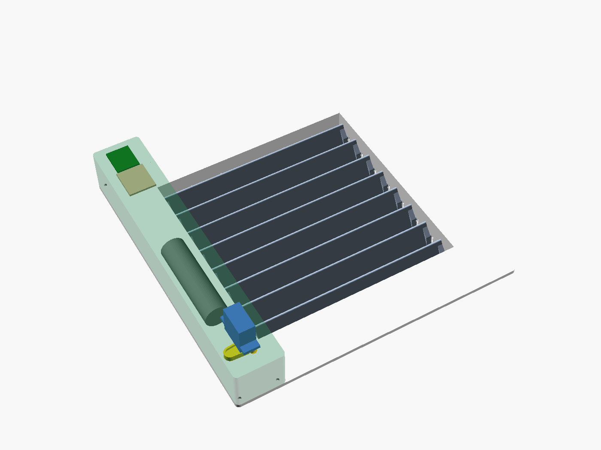
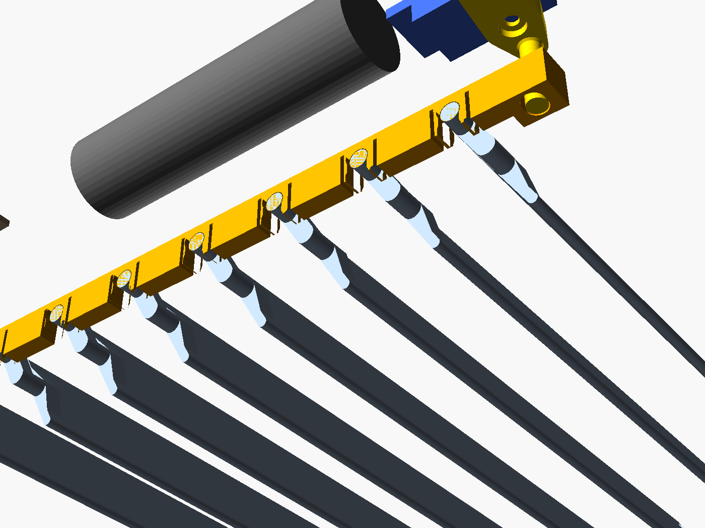

# Alternative: komplett gedrucktes Lamellengitter

Statt einen Aktor auf den Drehknopf des Edelstahlgitters zu setzen, ersetzt dieses Gitter das
alte vollständig. Rahmen, Lamellen, Gestänge und Gehäuse sind gedruckt; zugekauft werden nur
dieselben Teile wie beim Aktor (MG90S, 18650, XIAO ESP32-C6, Lochrasterplatine) und
ein paar kleine Schrauben. Elektronik und Firmware bleiben unverändert.



Modell: [`lamellengitter.scad`](lamellengitter.scad) (OpenSCAD, parametrisch).

## Aufbau

```
   Schnitt von oben (Raum oben, Schacht unten)

   ┌──────── Haube (Servo, Akku, XIAO) ────────┐
   │              Servo, darunter Kurbel        │
═══╧══════════════════ Blende ══════╤═══════════╧═════════════════════  Wand
          │ Koppel-   Kurbeln │Lager-│   ═══   ═══   ═══   Lamellen     │Lager-
          │ stange            │wand  │                                  │wand
          └── Tasche (zu) ────┘      └──────────── Luftkanal ───────────┘
```

- **Rahmen** = Blende (227,5 × 227,5 × 3 mm, so groß wie das alte Gitter) und Einschub, der
  30 mm tief im Schacht steckt. Vier Federzungen oben und unten klemmen ihn wie das alte
  Gitter, ohne Schrauben.
- **Lamellen** (8 Stück bei 180 mm Schachthöhe): Zapfen 4 mm, die von hinten in Schlitze der
  beiden Lagerwände schnappen. Zu = 15° (die Lamellen überlappen sich um 3 mm), offen = 90°.
  Der Hub ist 75°, also wie beim alten Gitter.
- **Gestänge**: Jede Lamelle trägt links eine Kurbel in einer geschlossenen Tasche neben dem
  Luftkanal. Die **Koppelstange** wird von hinten auf alle Kurbelzapfen geklipst, so drehen
  alle Lamellen gleich (Parallelkurbel). Nichts davon liegt im Luftstrom.
- **Antrieb**: Der Servo steht kopfüber in der Haube auf dem linken Blendenrand. Seine
  **Kurbel** greift mit einem Zapfen durch einen Bogenschlitz in der Blende in das Langloch
  des Kulissensteins unten an der Koppelstange. Der Servo dreht dafür nur ±40°.
- **Haube** (38 × 227,5 × 36 mm): Servo, 18650 und Elektronik hängen darin am Deckel und wird
  mit 4 × M2 von hinten durch die Blende verschraubt. Die USB-C-Buchse des XIAO liegt an der
  oberen Stirnseite frei, zum Laden muss also nichts geöffnet werden.



### Unterschiede zum Aktor

| | Aktor auf dem Knopf (z. B. „stirn“) | gedrucktes Gitter |
|---|---|---|
| altes Gitter | bleibt | wird ersetzt |
| Überstand zur Möbelseite | Zahnräder 10 mm über den Rahmenrand | **keiner**, alles innerhalb der Blende |
| Befestigung | VHB auf dem Edelstahlrahmen | klemmt im Schacht wie bisher |
| Kopplung | Hülse auf Knopf, Spiel im Knopfmechanismus | direkt über Kurbeln, kein Knopf |
| Höhe vor der Wand | 35 mm (Servoturm) | 39 mm (Blende + Haube) auf 38 mm Breite |
| Material (Volumen der Teile) | klein | ca. 255 cm³, davon Rahmen 130 cm³ |
| Risiko | Passform am Knopf | Passform im Schacht, Wärme an den Lamellen |

## Vor dem Druck messen

Die Schachtmaße sind **Annahmen**. Bekannt sind nur die 227,5 mm Höhe des alten Gitters und
der 25 mm breite Rand.

| Parameter | Bedeutung | Standard |
|---|---|---|
| `schacht_w`, `schacht_h` | lichte Breite und Höhe der Wandöffnung (altes Gitter herausziehen) | 180 / 180 |
| `einschub` | wie tief der Schacht hinter der Wand frei ist (mind. 27 mm) | 30 |
| `rand` | wie weit die Blende die Wand überdeckt | 23,75 |
| `spiel` | Luft je Seite zwischen Einschub und Schacht | 1 |
| `klemm_ueber` | wie stark die Federzungen gegen die Schachtwand drücken | 0,8 |

Die Blende muss auf die Druckplatte des A1 passen (`schacht + 2 × rand ≤ 256`), OpenSCAD bricht
sonst mit einer Meldung ab. Die Zahl der Lamellen ergibt sich aus der Schachthöhe.

Erst die Proben drucken (`export/gitter/gitter_proben.3mf`, ca. 1 h):

1. **`probe_einschub`** – Rahmenkontur, 15 mm tief, mit Federzungen. In den Schacht stecken:
   Sie soll mit leichtem Druck hineingehen und von selbst halten. Zu locker → `klemm_ueber`
   erhöhen, klemmt sie schon an den Wänden → `spiel` erhöhen oder `schacht_w/h` korrigieren.
2. **`probe_lager`** – Wandstück mit Schnappschlitz und Lamellenstummel. Der Zapfen soll
   hörbar einrasten und sich danach leicht drehen. Zu fest → `schnapp` verkleinern, fällt er
   heraus → vergrößern. Derselbe Schlitz sitzt in der Koppelstange.

## Dateien

`python3 tools/export.py gitter` erzeugt [`export/gitter/`](export/gitter/):

| Datei | Inhalt | Druck |
|---|---|---|
| `gitter_rahmen.3mf` | Rahmen | Blende aufs Bett (Texturplatte ergibt eine schöne Front), keine Stützen |
| `gitter_lamellen.3mf` | 8 Lamellen | flach, Zapfen und Kurbeln liegen auf dem Bett, keine Stützen |
| `gitter_antrieb.3mf` | Haube, Koppelstange, Servokurbel | Haube mit dem Deckel aufs Bett; Koppelstange auf der Seite (Kerben senkrecht); Kurbel mit der Horntasche aufs Bett, Zapfen nach oben, 100 % Infill |
| `gitter_proben.3mf` | Passproben | siehe oben |
| `stl/*.stl` | alle Teile einzeln | |
| `lamellengitter_baugruppe.step`, `step/*.step` | Onshape: Teile in Einbaulage (Lamellen offen) mit Platzhaltern für Servo, Akku und Schacht | facettiert |

Alle Teile drucken ohne Stützen. Die Haube braucht über dem USB-C-Ausschnitt eine 12-mm-Brücke.

### Material

Die Lamellen liegen direkt im warmen Luftstrom. Zuerst die Lufttemperatur am Auslass bei
Volllast messen:

| Lufttemperatur | Lamellen, Koppelstange | Rahmen, Haube |
|---|---|---|
| < 60 °C | PETG | PETG |
| 60–80 °C | **ASA** (Brim, Karton-Haube gegen Zugluft) | PETG, Rahmen besser ASA |
| > 80 °C | nicht geeignet, beim Aktor bleiben | |

PLA nicht verwenden. Bei ASA auf dem offenen A1 den großen Rahmen mit Brim drucken, er neigt
zum Verziehen.

### Prüfung

```sh
.venv/bin/python tools/check_gitter.py
```

rendert alle Teile in Einbaulage bei 0, 25, 50, 75 und 100 % Öffnung und prüft, dass sich nichts
durchdringt: Lamellen untereinander und gegen Rahmen, Koppelstange und Kurbel, die Servokurbel
gegen Blende, Haube und Servo, außerdem Servo und Akku in der Haube. Eine Gegenprobe (zu weit
geschlossene Lamellen) muss anschlagen. Nach jeder Parameteränderung laufen lassen.

## Montage

1. **Servokurbel:** Das einarmige Horn (ungekürzt) in die Tasche der Kurbel legen und mit der
   Hornschraube von der Zapfenseite auf die Servowelle schrauben. Der Zapfen zeigt in
   Mittelstellung quer zur Haube, Richtung Lamellen (siehe Kalibrierung unten). Zusätzlich
   zwei kleine Hornschrauben durch die Hornlöcher in die Kurbel drehen, wie bei „stirn“.
2. **Haube bestücken:** Den Servo kopfüber zwischen die beiden Säulen setzen und durch die
   Laschen festschrauben. Den Akku von unten in die beiden Wiegen klipsen. Platine und XIAO
   mit Schaumklebeband unter den Deckel kleben, die USB-C-Buchse zur Öffnung an der Stirnseite.
   Verdrahtung wie beim Aktor (`README.md`, Abschnitt Elektronik).
3. **Lamellen:** Den Rahmen mit der Blende nach unten hinlegen. Jede Lamelle von hinten in die
   Schlitze drücken, bis beide Zapfen einrasten. Die Kurbeln liegen in der linken Tasche.
4. **Koppelstange:** Alle Lamellen gleich stellen und die Koppelstange von hinten auf die
   Kurbelzapfen klipsen, der Kulissenstein unten.
5. **Haube aufsetzen:** Den Zapfen der Servokurbel durch den Bogenschlitz in das Langloch des
   Kulissensteins führen und die Haube mit 4 × M2 × 8 (Senkkopf) von hinten durch die Blende
   verschrauben.
6. Das Gitter in den Schacht drücken. Zum Reinigen wieder herausziehen; die Lamellen lassen
   sich nach hinten aus den Schlitzen ziehen.

## Kalibrieren

Der Servo braucht nur ±40° um die Mitte. Die Firmware-Standardwerte (600/2400 µs) würden ihn
gegen das Ende des Bogenschlitzes fahren. **Vor dem Einbau** mit engeren Werten flashen:

```sh
LAMELLE_CLOSED_US=1060 LAMELLE_OPEN_US=1940 cargo run --release
```

1. Flashen, solange die Kurbel noch nicht auf dem Servo sitzt. Der Servo fährt auf „offen“.
2. Die Lamellen von Hand ganz öffnen (90°). Die Kurbel so aufsetzen, dass ihr Zapfen in den
   Kulissenstein passt. Die Kerbverzahnung rastet in 18°-Schritten, den Rest gleicht Schritt 3
   aus.
3. Beide Werte so anpassen, dass „0 %“ genau zu (15°) und „100 %“ genau offen ist. Schließt das
   Gitter bei 100 %, die Werte tauschen.

Die Lamellenstellung folgt dem Sollwert nicht ganz linear (Kurbel und Kulisse), für die
Regelung in Home Assistant spielt das keine Rolle. Die 15 % Mindestöffnung der Firmware
bleiben wirksam.
