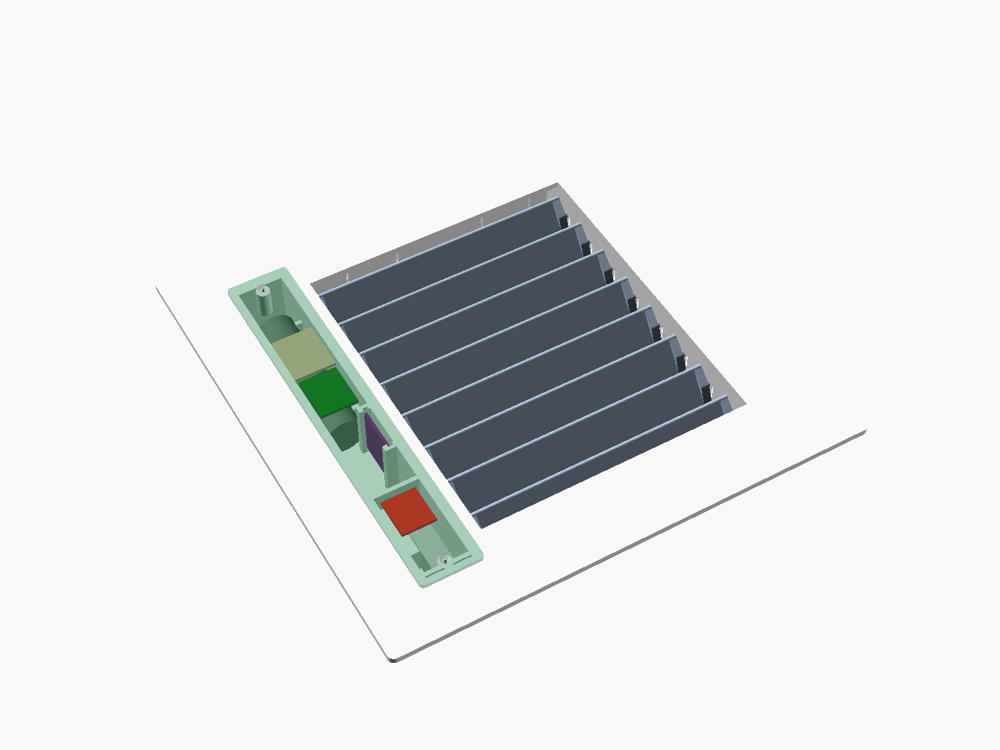
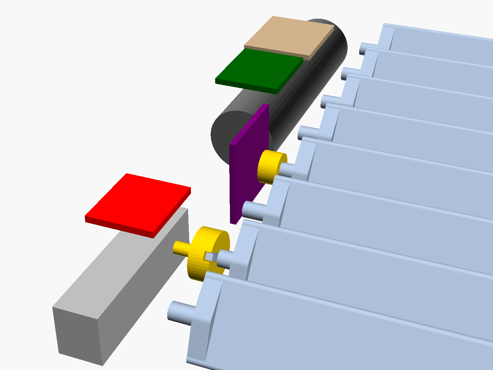
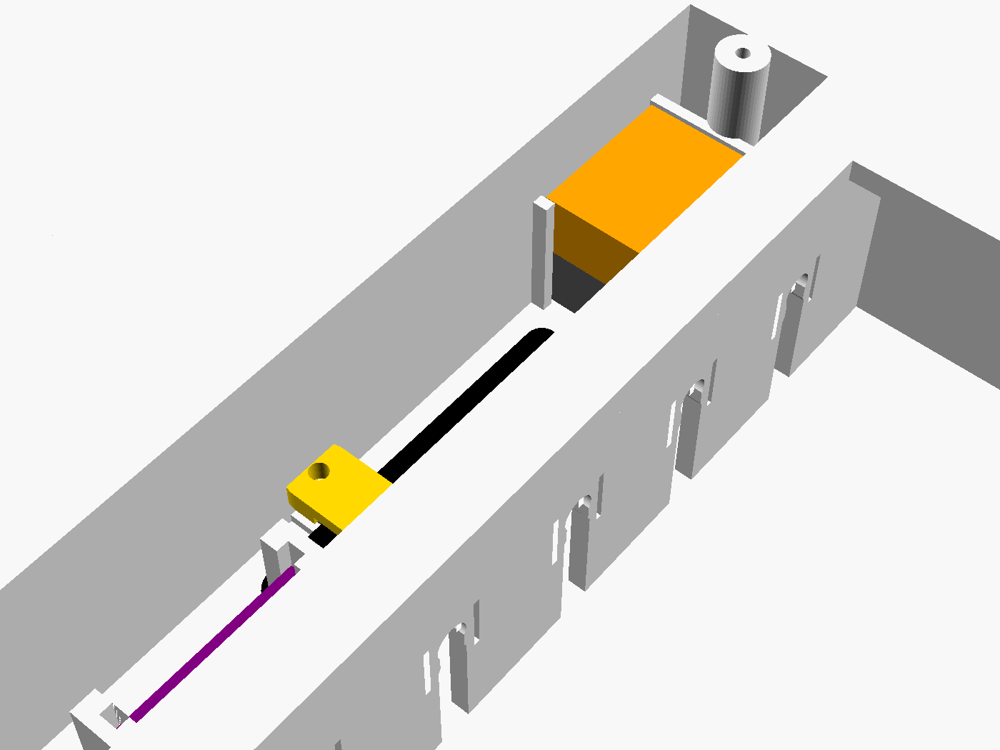

# Gedrucktes Lamellengitter, Variante „schnecke“

Flaches Gitter ohne Haube: Akku, Elektronik und Antrieb sitzen in einer gedämmten Kammer im
Schacht. Ein N20-Getriebemotor mit Schneckengetriebe treibt die Lamellen. Er ist
selbsthemmend, deshalb hält die Stellung ohne Strom, und der Luftstrom kann die Lamellen nicht
verstellen. Ein AS5600 misst die Stellung absolut, eine Referenzfahrt braucht es nicht.



Modell: [`lamellengitter_schnecke.scad`](lamellengitter_schnecke.scad). Die Servo-Variante
mit Haube ([`GITTER.md`](GITTER.md)) bleibt daneben bestehen.

## Aufbau

```
   Schnitt von oben (Raum oben, Schacht unten)

 Deckel ┌─────────┐
═══════╧═════════╧══════ Blende ══════╤═══════════════════════════╤══════════  Wand
   ║ ░ │ Akku,    │ Spalt  │Lager-│  ═══   ═══   ═══  Lamellen  │Lager-│Kurbeln, │
   ║ ░ │ Motor,   │ 6 mm   │wand  │                             │wand  │Koppel-  │
   ║ ░ │ AS5600   │Kupplung│      │                             │      │stange   │
   ║ ░ └──────────┘        │      │                             │      │         │
   ║ ░░░░░░░░░░░░░         └──────┴──────── Luftkanal ──────────┘      └─────────┘
   ╚═ Doppelwand mit 2,5 mm Luft (hinten und zur Schachtwand)
```

- **Kammer** (21 × 174 × 25 mm) links im Einschub. Zum Luftkanal trennt sie ein 6 mm breiter
  Luftspalt, nach hinten und zur Schachtwand eine Doppelwand mit 2,5 mm Luft. Nach vorn
  schließt sie nur ein 2 mm dünner **Deckel** (2 × M2) ab, über den sie Wärme an den Raum
  abgibt. Die Antenne des XIAO liegt direkt hinter dem Deckel.
- **Lamellen** (8 Stück, 19 mm breit, Teilung 20 mm) überlappen sich nicht. Zu = 0° (alle in
  einer Ebene, 1 mm Spalt), offen = 90°.
- **Antrieb:** Die Abtriebswelle des Motors geht durch die Kammerwand. Im Spalt sitzt eine
  **Kupplung**, in deren Nut die Klaue der **Antriebslamelle** greift. Die Klaue steht bei
  „zu“ quer zur Wand, so lässt sich die Lamelle von hinten einsetzen.
- **Stellung:** Auf dem Zapfen einer anderen Lamelle sitzt im Spalt der **Magnethalter** mit
  einem Diametralmagneten 6 × 2,5 mm. Der AS5600 steht in der Kammer dahinter und liest ihn
  durch die 1,2 mm dünne Kammerwand (Abstand Magnet–Chip ca. 2,5 mm).
- **Koppelstange** rechts in einer Tasche: Sie hält alle Lamellen gleich, wie bei der
  Servo-Variante.
- Alle Kabel bleiben in der Kammer, nichts läuft durch den Luftkanal.



### Im Vergleich

| | Servo-Variante (`GITTER.md`) | **schnecke** |
|---|---|---|
| vor der Wand | Haube 36 mm hoch | **nur Blende und Deckel (5 mm)** |
| Luftkanal (Breite bei 180 mm Schacht) | 162 mm | 130 mm (−20 %) |
| hält die Stellung | Servo, im Stand stromlos | Schnecke, selbsthemmend |
| Stellung | gesteuert, nicht gemessen | **gemessen** (AS5600), wird an HA gemeldet |
| 5-V-Wandler, P-MOSFET | nötig | entfallen, Motor läuft am Akku |
| Elektronik-Temperatur | Raum | zwischen Raum und Warmluft, **messen** |
| Laden | USB-C frei an der Haube | Deckel abnehmen (2 Schrauben) |

## Wärme: vorher messen

Die Dämmung verzögert die Erwärmung nur. Nach einigen Stunden Heizbetrieb stellt sich in der
Kammer eine Temperatur zwischen Raum- und Warmluft ein. Grob gerechnet sind es bei 55 °C
Warmluft und 21 °C im Raum etwa **40–47 °C**.

| Bauteil | Grenze |
|---|---|
| 18650 laden | 45 °C |
| 18650 betreiben | 60 °C (altert darüber schneller) |
| N20-Motor | meist bis 60 °C (Datenblatt des Händlers prüfen) |
| DRV8833, AS5600, XIAO | 85 °C |

- Die Lufttemperatur am Auslass bei Volllast messen. Bis etwa 50 °C passt es.
- Der Lader auf dem XIAO hat keinen Temperaturfühler. **Nur bei kalter Heizung laden.**
- Material: Rahmen und Lamellen PETG bis 60 °C Luft, darüber ASA (siehe `GITTER.md`).
- Mit **Versorgung über Kabel** (nächster Abschnitt) fallen die Akkugrenzen weg. Es bleiben
  60 °C für den Motor und 85 °C für die Elektronik.

## Versorgung über Kabel statt Akku

Statt des 18650 kann ein 12-V-Netzteil an der Heizung alle Gitter versorgen. Das Kabel läuft
durch den Schacht und wird **durchgeschleift**: von der Heizung ins erste Gitter, von dort als
neues Kabelstück ins nächste. Im Schacht gibt es keine einzige Verbindungsstelle, alle
Klemmen liegen in den Kammern.

```
 Steckdose ─ 12-V-Netzteil ─┬─ Sicherung 1 A ─ Schacht 1 ─► Gitter A ─► Gitter B ─► Gitter C
 (an der Heizung)           ├─ Sicherung 1 A ─ Schacht 2 ─► Gitter D ─► Gitter E
                            ├──────────────────────────────► Wohnzimmer (kurzes Kabel)
                            └──────────────────────────────► Küche (kurzes Kabel)

 In jedem Gitter:
   Kabel „ein“ ──┐   WAGO 221-413 (+12 V): ein | weiter | Abgang ─► SS14 ─► Wandler 12 → 5 V
   Kabel „weiter“┘   WAGO 221-413 (GND):   ein | weiter | Abgang ─────────► Wandler GND
                                     5 V ─► XIAO 5V, DRV8833 VM
                     12 V ─ 100 kΩ ─ D0 ─ 10 kΩ ─ GND   (Versorgungsspannung melden)
```

Modell: `versorgung = "kabel";` oben in `lamellengitter_schnecke.scad`. Export:
`python3 tools/export.py gitter_schnecke_kabel` → [`export/gitter_schnecke_kabel/`](export/gitter_schnecke_kabel/).



### Was sich am Gitter ändert

- **Kein Akku:** Die Kammer wird 19,5 statt 21 mm breit. Schmaler geht nicht, weil die
  WAGO-Klemme 18,6 mm breit ist und mit dem Hebel zum Deckel liegen soll. Der Luftkanal wird
  dadurch nur 1,5 mm breiter (131 mm).
- **Kabeldurchführung:** Beide Kabel kommen nebeneinander durch ein Langloch hinten in der
  Kammer, etwa auf halber Höhe. Eine Hülse in der Doppelwand hält die Luftschicht geschlossen.
  Das Kabel von unten läuft hinter dem Gitter im Schacht hoch.
- **Zugentlastung:** Der Schacht ist senkrecht, das Kabel hängt also am Gitter. Gleich hinter
  dem Langloch knicken beide Kabel nach oben ab und liegen auf zwei Querrippen. Der gedruckte
  **Klemmbügel** drückt sie mit 2 × M2 × 8 dagegen (Wellenprofil, `kabel_quetsch` = 0,8 mm).
  Die WAGO-Klemmen sind dadurch nie auf Zug belastet. Die beiden Dome des Klemmbügels sind beim
  Druck knapp 4 mm Überhang, das geht ohne Stützen.
- **WAGO-Tasche** oben in der Kammer: zwei 221-413 übereinander, Leitereinführung nach unten.
  Die Klemmen vor dem Einlegen anschließen und schließen. Die obere (+12 V) zeigt mit dem Hebel
  zum Deckel, die untere (GND) liegt darunter. Ein Streifen Schaumklebeband hält sie.
- Der **Wandler** (z. B. Mini-360) klebt neben XIAO und Lochraster unter dem Deckel.
- Maße zum Nachmessen: `kabel_d` (Außendurchmesser), `wago` (Länge, Breite, Dicke).

### Kabel im Schacht

- 2 × 0,5 mm², hitzefest (Silikon oder PTFE, ≥ 105 °C), SELV 12 V.
- Bei 10 m und 0,5 A gehen ca. 0,2 V verloren. Das ist egal, der Wandler regelt auf 5 V.
- An der Schachtwand befestigen, **ober- und unterhalb jedes Auslasses**, damit das Gitter nicht
  das ganze Kabel trägt. Nicht am Wärmetauscher entlang führen.
- An jedem Gitter etwa 30 cm Reserveschlaufe lassen, damit es sich zum Reinigen herausziehen
  lässt.
- Eine lose Klemme unterbricht alle Gitter dahinter. Deshalb jeden Leiter nach dem Schließen
  der WAGO-Klemme mit einer Zugprobe prüfen.
- Leitungen in Warmluftschächten mit dem Schornsteinfeger oder Heizungsbauer abklären,
  besonders wo der Schacht Decken oder Brandwände durchquert.

### Firmware und Verhalten

```sh
LAMELLE_ROOM=kueche LAMELLE_CLOSED_RAW=<zu> cargo run --release --features schnecke,netz
```

- Keine Akkugrenzen. Der Knoten meldet die 12-V-Spannung im Feld `battery_mv` und setzt das
  Statusbit `MAINS_POWERED`.
- Takt 60 s statt 300 s (vom Gateway ab 5 s einstellbar). Der Fail-Safe greift wie bisher
  nach 3 h ohne Gateway.
- **Fällt das Netzteil aus, bleibt das Gitter stehen.** Die Schnecke hält die Stellung, und es
  gibt keine Energie mehr, um zu öffnen. Die Absicherung ist dann die Mindestöffnung von 15 %,
  unter die kein Gitter je fährt.
- Der XIAO hängt am 5-V-Pin. **Nicht gleichzeitig USB und 12 V anschließen**, oder vorher eine
  Diode in die 5-V-Leitung setzen.

## Teile

| Teil | Bemerkung |
|---|---|
| N20-Getriebemotor mit **Schneckengetriebe**, 6 V, Abtrieb 90° zur Motorachse, 10–30 U/min | Maße unbedingt nachmessen (`getr_l`, `getr_b`, `getr_h`, `motor_l`, `welle_*`). Bei 3,7 V läuft er etwa 40 % langsamer; 90° dauern dann ca. 0,5–1,5 s |
| DRV8833-Modul | VM direkt an den Akku |
| AS5600-Modul (23 × 23 mm) mit Diametralmagnet 6 × 2,5 mm | DIR an GND |
| 18650, XIAO ESP32-C6, Lochraster, Spannungsteiler | wie bisher; 5-V-Wandler und P-MOSFET entfallen |
| *nur bei Kabel:* 12-V-Netzteil, Wandler 12 → 5 V (Mini-360), 2 × WAGO 221-413, SS14, 100 kΩ/10 kΩ, hitzefestes Kabel 2 × 0,5 mm² | statt 18650 |

### Verdrahtung

```
 18650 (+) ──┬── XIAO BAT+             XIAO ESP32-C6
             ├── DRV8833 VM            D0 / GPIO0  ◄── Spannungsteiler 1 MΩ/1 MΩ (+100 nF)
             └── 1 MΩ ─ D0 ─ 1 MΩ ─ GND D1 / GPIO1  ──► DRV8833 nSLEEP (nur während der Fahrt)
                                       D2 / GPIO2  ──► DRV8833 AIN1
 Motor ── DRV8833 AOUT1 / AOUT2        D3 / GPIO21 ──► DRV8833 AIN2
                                       D4 / GPIO22 ◄─► AS5600 SDA
 AS5600: VCC ◄── D8 / GPIO19           D5 / GPIO23 ──► AS5600 SCL
         DIR ── GND, GND ── GND
 18650 (−) ──── GND (XIAO BAT−, DRV8833, AS5600)
```

Der AS5600 wird über GPIO19 nur in der Wachphase versorgt (6,5 mA). Der DRV8833 braucht mit
nSLEEP auf low unter 2 µA. Im Deep-Sleep ziehen Motor und Sensor also nichts.

## Dateien

`python3 tools/export.py gitter_schnecke` erzeugt [`export/gitter_schnecke/`](export/gitter_schnecke/):

| Datei | Inhalt | Druck |
|---|---|---|
| `schnecke_rahmen.3mf` | Rahmen mit Kammer | Blende aufs Bett, keine Stützen. Die Rückwände der Kammer und die Akkuwiegen sind 21-mm-Brücken |
| `schnecke_lamellen.3mf` | 7 Lamellen + 1 Antriebslamelle (mit Klaue) | flach |
| `schnecke_kleinteile.3mf` | Deckel, Koppelstange, Kupplung, Magnethalter | Kupplung und Halter mit der Nut bzw. Magnettasche oben, 100 % Infill |
| `schnecke_proben.3mf` | Passproben für Schacht und Schnapplager | |
| `stl/`, `step/`, `lamellengitter_schnecke_baugruppe.step` | Einzelteile, Onshape | |

Prüfung: `.venv/bin/python tools/check_gitter.py schnecke` rendert die Teile bei 0–100 %
Öffnung und prüft Lamellen, Koppelstange, Kupplung, Magnethalter, Motor, Elektronik und Deckel
gegeneinander. Eine Gegenprobe muss anschlagen.

## Montage und Kalibrierung

1. **Kalibrier-Firmware flashen** (kein Funk, kein Schlaf; der Monitor zeigt laufend den
   Rohwinkel):
   ```sh
   cd firmware/node
   LAMELLE_KALIBRIEREN=1 cargo run --release --features schnecke
   ```
   Solange die **BOOT**-Taste gedrückt ist, fährt der Motor langsam. Jedes neue Drücken kehrt
   die Richtung um.
2. **Kammer bestücken:** Den Motor mit der Welle durch die Kammerwand stecken, das Getriebe
   liegt am Abstandsring an. Ein Tropfen Heißkleber hält ihn. Das AS5600-Modul von vorn in die
   Schienen schieben, Chip zur Kammerwand. Den Akku in die Wiegen klipsen, den DRV8833 vor den
   Motor, XIAO und Lochraster mit Schaumklebeband unter den Deckel kleben.
3. **Kupplung** im Spalt auf die Motorwelle stecken. Mit BOOT drehen, bis die Nut quer zur
   Wand steht (in Richtung Schacht).
4. **Lamellen** von hinten einschnappen, alle flach (zu). Zuerst die Antriebslamelle mit
   ihrer Klaue in die Nut der Kupplung. Vor dem Einsetzen der Sensorlamelle den Magneten in den
   Magnethalter kleben und den Halter auf ihren abgeflachten Zapfen stecken. Danach die übrigen
   Lamellen.
5. **Koppelstange** rechts von hinten auf die Kurbelzapfen klipsen.
6. **Werte ablesen:** In der Stellung „zu“ (flach) den Rohwinkel notieren. Mit BOOT auf 90°
   fahren und auch diesen Wert notieren. Er sollte etwa 1024 Schritte weiter liegen.
7. **Normale Firmware flashen:**
   ```sh
   LAMELLE_ROOM=kueche LAMELLE_CLOSED_RAW=<zu> LAMELLE_OPEN_RAW=<offen> cargo run --release --features schnecke
   ```
   Wie herum der Motor angeschlossen ist, lernt die Firmware bei der ersten Fahrt selbst.
8. Deckel aufschrauben, Gitter in den Schacht drücken.

Die Firmware meldet die **gemessene** Öffnung an das Gateway. Fehlt der Magnet, antwortet der
Sensor nicht oder ist der Antrieb blockiert, setzt sie das Statusbit `DRIVE_FAULT` und fährt
nicht. Das Gitter bleibt dann stehen, wo es ist, auch beim Fail-Safe. Home Assistant sollte
bei `DRIVE_FAULT` warnen. Die 15 % Mindestöffnung und der Fail-Safe gelten sonst unverändert.
