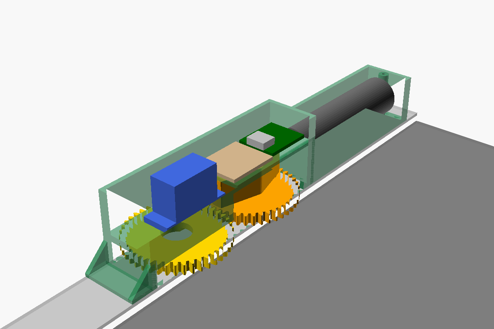
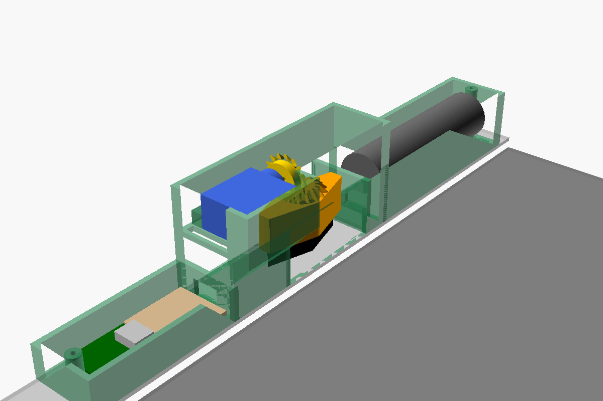
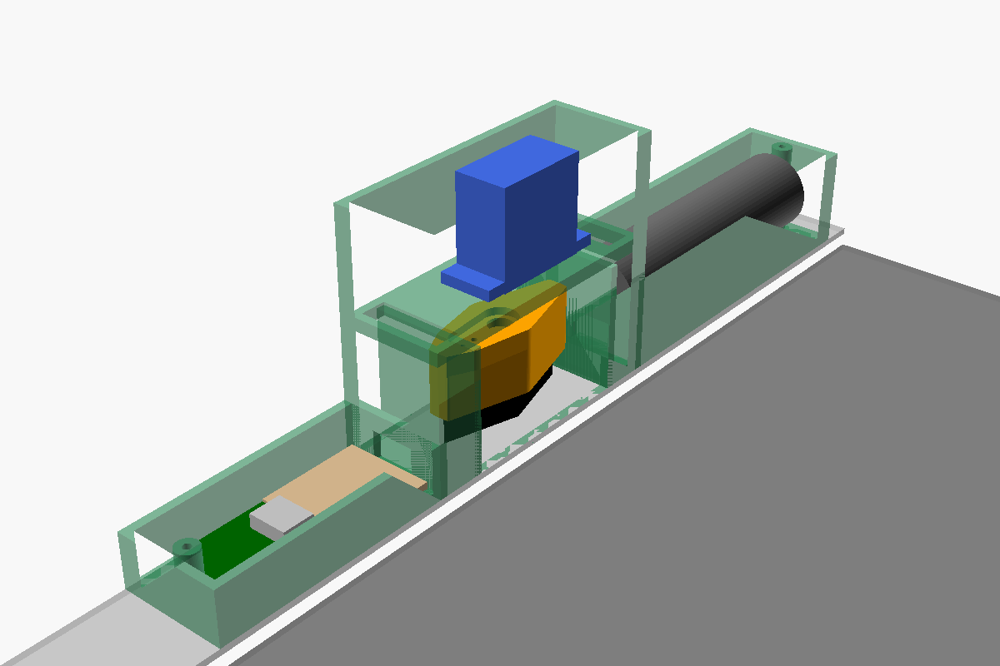
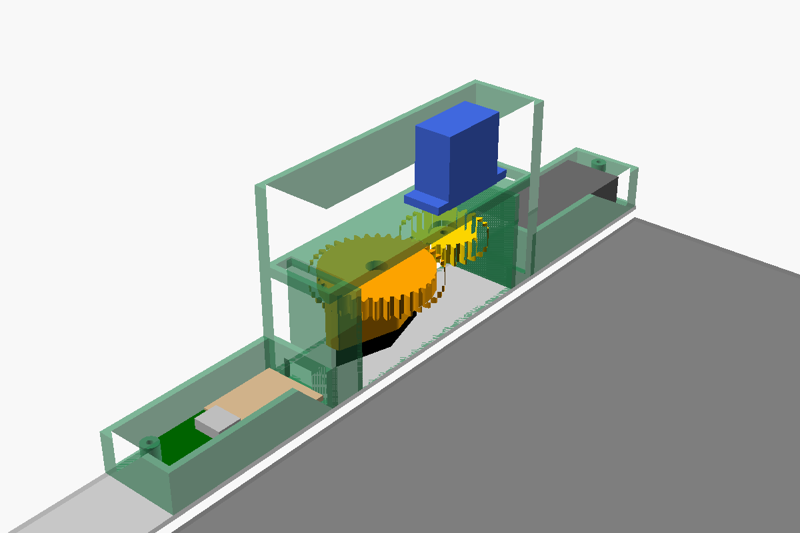

# Hardware: Lamellen-Aktor

Für Edelstahl-Lüftungsgitter mit einem kleinen, rautenförmigen Drehknopf auf dem
Rahmenrand. Der Knopf ist 35 × 10 mm groß und ragt 17 mm heraus. Er dreht 180° und verstellt
die Lamellen dabei um ca. 75°. Im geschlossenen Zustand überlappen sich die Lamellen.

Servo, Akku und Mikrocontroller sitzen in **einem** Gehäuse auf dem 25 mm breiten
Rahmenrand. Nur der Servoturm am Knopf ist hoch, Akku und Elektronik liegen flach daneben.



## Dateien für Bambu Studio und Onshape

Fertige Exporte der Standardvariante „stirn“ liegen in [`export/stirn/`](export/stirn/):

| Datei | Wofür |
|---|---|
| `lamellen_stirn.3mf` | **Bambu Studio**: alle Druckteile, richtig ausgerichtet, auf einer Platte (195 × 187 mm). Öffnen, Material PETG wählen, für das Gehäuse Baumstützen aktivieren. |
| `stl/*.stl` | dieselben Teile einzeln, z. B. um nur die Hülse als Passprobe zu drucken |
| `lamellen_stirn_baugruppe.step` | **Onshape**: alle Teile in Einbaulage, benannt und eingefärbt, dazu Platzhalter für Servo, Knopf, Akku, Elektronik und Rahmen (`ref_*`) |
| `step/*.step` | **Onshape**: jedes Teil einzeln in Einbaulage |

In Onshape: *Import* → STEP-Datei wählen → „Import as a single part studio“ für die
Baugruppe.

### Exaktes CAD-Modell

Die Variante „stirn“ gibt es zusätzlich als exaktes CAD-Modell in
[`cad/lamellen.py`](cad/lamellen.py) (CadQuery). Daraus stammen die STEP-Dateien:

- Bohrungen, Dome und Rundungen sind echte Zylinderflächen, die Zahnflanken echte
  Evolventen (Spline-Flächen). In Onshape lassen sich Flächen deshalb sauber auswählen,
  bemaßen, verschieben („Move face“) und mit eigenen Features ergänzen.
- Die Maße (Knopf, Rahmen, Servo, Zahnräder, Akku …) stehen gesammelt in der Klasse
  `Params`. Alle abgeleiteten Maße werden daraus berechnet. Ein geänderter Parameter
  ergibt nach einem Export neue Dateien.
- Onshape selbst kennt diese Parameter nicht: Die STEP-Dateien enthalten exakte Geometrie,
  aber keine Konstruktionshistorie. Wer in Onshape über eine Variable die Knopfgröße ändern
  will, bräuchte ein eigenes FeatureScript.

`tools/check_cad.py` prüft, dass CadQuery- und OpenSCAD-Modell übereinstimmen (gleiche
Volumina je Teil). Außerdem testet es im exakten Modell den Zahneingriff (mit Gegenprobe), den
freien Drehweg der Hülse über 180° und die Passung von Servo, Akku, Elektronik und Deckeln.
**Parameter immer in beiden Modellen ändern** und danach die Prüfung laufen lassen.

```sh
python3 -m venv .venv && .venv/bin/pip install -r tools/requirements.txt
.venv/bin/python tools/check_cad.py         # beide Modelle vergleichen, Kollisionen prüfen
.venv/bin/python tools/export.py            # „stirn“ aus CadQuery (exakt)
.venv/bin/python tools/export.py kegel      # andere Varianten aus OpenSCAD (facettiert)
```

## Varianten

| | **„stirn“ (Standard)** | „kegel“ | „direkt“ | „getriebe“ |
|---|---|---|---|---|
| Antrieb | Zahnkranz an der Hülse, MG90S (180°) steht kopfüber unter dem Knopf, Stirnräder 1:1 | MG90S liegt flach, zwei Kegelräder 1:1 | MG90S steht koaxial vor dem Knopf | 270°-Servo versetzt, Stirnräder 1:1,5 |
| Höhe Servoturm | **35 mm** | 41 mm | 57 mm | 60 mm |
| Gehäuselänge | **187 mm** | 215 mm | 201 mm | 208 mm |
| Überstand seitlich | Zahnräder 9,5 mm auf **beiden** Seiten (nur 2,5–7 mm über dem Rahmen) | Servo 4,3 mm zur Lamellenseite | – | – |
| Zahnräder | robuste Stirnräder | kleine Kegelräder, druckkritisch | keine | Stirnräder |
| Servo befestigt mit | Laschen (verschraubt) | Bett und Niederhalter | Laschen | Laschen |
| Akku | 18650 oder LiPo | 18650 oder LiPo | 18650 oder LiPo | nur LiPo |
| Bild |  |  |  |  |

Variante wählen: `variante = "stirn";` (oder `"kegel"`, `"direkt"`, `"getriebe"`) oben in
`lamellen_aktor.scad`.

### Hinweise zur Variante „stirn“

- Der Zahnkranz umschließt die Hülse direkt über dem Rahmen. Deshalb hat er 44 mm
  Außendurchmesser und ragt auf **beiden** Seiten 9,5 mm über den Rahmenrand, ebenso das
  gleich große Ritzel darunter. **Prüfen, ob zum Möbel hin 10 mm frei sind.** Die
  Knopfspitzen brauchen schon heute 5 mm.
- Der Servo steht kopfüber: Welle und Ritzel zeigen zum Rahmen, die Laschen liegen auf einem
  Boden und werden verschraubt. Das volle einarmige Horn liegt in der Tasche des Ritzels,
  ungekürzt.
- Platine und XIAO liegen auf einer Ablage über der Hülse. Ein eigenes Elektronikfach gibt es
  nicht, deshalb ist das Gehäuse kürzer.
- Nachmessen: `servo_shaft_h` (Servo-Oberseite bis Hornauflage) und `servo_tab_from_top`
  (Oberseite bis Unterseite der Laschen).
- Funk: Der XIAO liegt nahe am 18650-Akku. Ist die Reichweite zu knapp, an den U.FL-Anschluss
  des XIAO eine kleine externe Antenne stecken und im Deckel verlegen.

### Warum Kegelräder und kein Kronenrad

Ein Kronenrad mit Stirnritzel funktioniert nur, wenn das Kronenrad deutlich mehr Zähne hat
als das Ritzel (etwa ab 2:1). Bei 1:1 werden seine Zähne innen vollständig unterschnitten.
Hier ist 1:1 nötig, weil Servo und Knopf beide 180° drehen. Für 1:1 im rechten Winkel ist ein
Paar gleicher Kegelräder die passende Bauform. Deren Achsen schneiden sich über der
Knopfmitte.

### Hinweise zur Variante „kegel“

- Die Servowelle sitzt nicht mittig im Gehäuse. Damit das Kegelrad genau über der Knopfachse
  steht, ragt der Servo **4,3 mm über den Rahmenrand zur Lamellenseite** (`servo_side = 1`).
  Zur Möbelseite ragt nichts über. Das Gehäuse hat dort eine Ausbuchtung, die erst über der
  Hülse beginnt.
- Die Befestigungslaschen des Servos werden nicht gebraucht und können abgeschnitten werden.
  Der Servo liegt in einem Bett mit Anschlägen, die Rippen im Turmdeckel drücken ihn nach
  unten. Ein Streifen dünner Schaumstoff dazwischen nimmt Toleranzen auf.
- `servo_shaft_h` (Oberseite des Servos bis zur Hornauflage, Standard 7 mm) am eigenen
  Servo nachmessen. Davon hängt ab, wo der Servo im Bett liegt.

## Platz am Gitter (gemessen)

107,5 mm unter und 120 mm über der Knopfmitte (`space_below`, `space_above`). OpenSCAD
bricht mit einer Meldung ab, wenn das Gehäuse über den Rahmen hinausragen würde.

| Variante, Akku | Gehäuselänge | über / unter der Knopfmitte | Höhe Turm / Akkufach / Elektronikfach |
|---|---|---|---|
| **stirn, 18650** | 187 mm | 109,5 / 77,5 mm | 35 / 25 / – mm |
| kegel, 18650 | 215 mm | 112 / 103 mm | 41 / 25 / 15 mm |
| direkt, 18650 | 201 mm | 112 / 89 mm | 57 / 25 / 15 mm |
| getriebe, LiPo | 208 mm | 119 / 89 mm | 60 / 17 / 15 mm |

```
          Seitenansicht (kegel, 18650)

                ┌───────────┐ 41 mm
                │Servo ⟂Kegel│      ┌──────────────────┐ 25 mm
   ┌──────┐     │   Knopf    │      │   18650-Akku     │
   │XIAO│Plat.  │            │      │                  │
═══╧════╧═══════╧════════════╧══════╧══════════════════╧═══ Rahmen
   ← unten  103 mm        Knopfmitte              112 mm  oben →
```

- **Kabel:** Aus den Fächern laufen die Kabel in je einen Schacht an den Turmenden. Von dort
  geht es über der Hülse bzw. durch das Servobett weiter, nie durch den Drehbereich des
  Knopfs.
- **Wärme:** Akku und Elektronik liegen direkt auf dem Rahmen, der Akku auf 2 mm hohen
  Rippen. In der ersten Heizwoche die Temperatur im Akkufach prüfen: Li-Ion nicht über 45 °C
  laden und nicht über 60 °C betreiben. Wird es zu warm, `rib_h` erhöhen.
- **Funk:** Der XIAO sitzt am unteren Ende, die Antenne zeigt zur Stirnwand und damit weg von
  Akku, Servo und Edelstahl.
- **Laden:** Deckel des Elektronikfachs abschrauben (1 × M2) und USB-C einstecken.

## Teile und Druck (Bambu A1)

| Teil | Material | Ausrichtung |
|---|---|---|
| `mitnehmer` – Rautenhülse mit Zahnkranz bzw. Kegelrad | PETG | Zahnkranz bzw. Öffnung nach unten, keine Stützen |
| `ritzel` – Ritzel bzw. Kegelrad für die Servowelle | PETG, 100 % Infill | „stirn“: Horntasche oben; „kegel“: Horntasche auf dem Bett, 0,12 mm Schichten |
| `gehaeuse` – Turm und Fächer in einem Stück | PETG | Rahmenseite aufs Bett, **Baumstützen** unter Servoboden, Ablage und den unten offenen Turmwänden |
| `deckel` – Turmdeckel (gesteckt) und zwei Fachdeckel (je 1 × M2) | PETG | flach, alle drei in einer Datei |

```sh
for p in mitnehmer ritzel gehaeuse deckel; do
  openscad -D "part=\"$p\"" -o "$p.stl" lamellen_aktor.scad
done
```

Erste Probe: nur den `mitnehmer` drucken und auf den Knopf stecken, um das Spiel (`fit`)
zu prüfen.

## Maße

| Parameter | Bedeutung |
|---|---|
| `knob_len`, `knob_w` | Länge und größte Breite der Raute (gemessen: 35 / 10 mm) |
| `knob_h` | wie weit der Knopf aus dem Rahmen ragt (gemessen: 17 mm) |
| `engage` | wie tief die Hülse über den Knopf greift (≤ `knob_h`) |
| `knob_angle` | Lage der Rautenlängsachse bei der Montage (90 = senkrecht) |
| `frame_w` | Breite des Rahmenrands = Gehäusebreite (gemessen: 25 mm) |
| `space_below`, `space_above` | Platz von der Knopfmitte bis zum Rahmenende (gemessen: 107,5 / 120 mm) |
| `akku` | `"18650"` oder `"lipo"` |
| `servo_shaft_h` | Servo-Oberseite bis Hornauflage (nachmessen) |
| `servo_side` | Seite, zu der der liegende Servo übersteht (1 = Lamellen) |

## Befestigung

Das Gitter ist nur geklemmt, und der Rahmen ist aus Edelstahl. Das Gehäuse wird mit den
Böden der beiden Fächer per **3M VHB** aufgeklebt (vorher mit Isopropanol entfetten, 24 h
aushärten lassen). Gitter und Aktor bleiben eine Einheit und lassen sich zum Reinigen zusammen
herausziehen.

## Montage

**Stirn (Standard):**
1. Das einarmige Horn in die Tasche des Ritzels legen. Mit der Hornschraube von der
   Rahmenseite aus auf die Servowelle schrauben (Stellung siehe Kalibrierung in
   `firmware/README.md`). Zusätzlich zwei kleine Hornschrauben von der Rahmenseite durch die
   Hornlöcher ins Ritzel drehen.
2. Den Servo kopfüber von oben in den Servoboden stecken und an den Laschen festschrauben.
3. Platine und XIAO auf die Ablage, den Akku ins Akkufach kleben und verdrahten.
4. Die Hülse auf den Knopf stecken, das Gehäuse darübersetzen (Ritzel und Zahnkranz müssen
   ineinandergreifen) und aufkleben. Dann die Deckel aufsetzen.

**Kegel:**
1. Ein einarmiges Horn auf **5 mm** ab Wellenmitte kürzen und in die Tasche des Kegelrads
   legen. Mit der Hornschraube von der Zahnseite aus auf die Servowelle schrauben (Stellung
   siehe Kalibrierung in `firmware/README.md`).
2. Die Befestigungslaschen des Servos abschneiden. Den Servo ins Bett legen, mit der Welle
   zum Knopf und dem langen Gehäuseteil zur Lamellenseite.
3. Akku, Platine und XIAO mit Schaumklebeband in die Fächer kleben. Die Kabel durch die
   Schächte führen und verdrahten.
4. Die Hülse auf den Knopf stecken, das Gehäuse darübersetzen (die Kegelräder müssen
   ineinandergreifen) und aufkleben. Dann die Deckel aufsetzen. Der Turmdeckel drückt den
   Servo ins Bett.

**Direkt:**
1. Das einarmige Horn mit der Mittelschraube auf den Servo schrauben.
2. Die Hülse mit der Tasche auf das Horn drücken. Die Hornachse muss dabei entlang der
   Rautenlängsachse liegen. Zwei kleine Hornschrauben von innen durch das Dach in die
   Hornlöcher drehen.
3. Den Servo von oben in den Zwischenboden stecken und an den Laschen festschrauben.
4. Weiter wie bei „kegel“ ab Schritt 3.

**Getriebe:**
1. Ein 270°-Microservo im MG90S-Format verwenden. Horn auf 6 mm kürzen, in die Tasche des
   Ritzels legen und das Ritzel mit der Mittelschraube auf die Welle schrauben.
2. Den Servo einsetzen, den Mitnehmer auf den Knopf setzen und das Gehäuse aufsetzen (der
   Zapfen greift in die Bohrung). Weiter wie bei „kegel“ ab Schritt 3.

## Elektronik je Knoten

```
 18650 (+) ──┬── XIAO BAT+            XIAO ESP32-C6
             │                         D0/GPIO0 ◄── Mitte Spannungsteiler 1 MΩ/1 MΩ (+100 nF nach GND)
             ├── 1 MΩ ── D0 ── 1 MΩ ── GND
             │                         D1/GPIO1 ──► Gate 2N7002 (Servo-Strom ein)
             └── AO3401 (P-MOSFET, Source) ── Drain ── 5-V-Boost ── Servo +
                   Gate: 100 kΩ nach Akku+,  über 2N7002 nach GND
                                       D2/GPIO2 ──► Servo-Signal
 18650 (−) ──── GND (XIAO BAT−, Boost, Servo)
```

- Der **P-MOSFET vor dem Boost** ist Pflicht. Ein abgeschalteter Aufwärtswandler lässt die
  Akkuspannung meist trotzdem zum Servo durch, und der Ruhestrom des Servos würde den Akku
  in Tagen leeren.
- 470 µF Elko direkt am Servo gegen Spannungseinbrüche beim Anlaufen.
- Laden über den USB-C-Anschluss des XIAO (Ladeschaltung auf dem Board).
- Die Bauteile sitzen auf einem Stück Lochraster (ca. 21 × 24 mm) im Elektronikfach.
