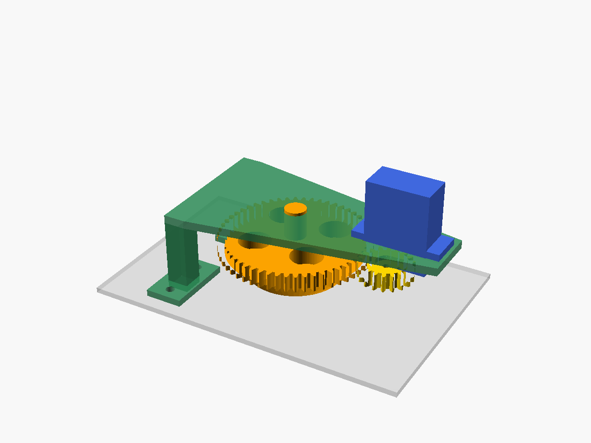

# Hardware: Lamellen-Aktor



Für Gitter, deren Lamellen über einen Flügelmutter-Drehknopf um 45° verstellt werden.
Der Knopf dreht sich nur und wandert dabei nicht vor oder zurück.

| Teil | Material (A1) | Hinweise |
|---|---|---|
| `mitnehmer` – Glocke über der Flügelmutter + Zahnrad 54 Z. | PETG, bei > 60 °C am Knopf ASA | Glocke auf dem Bett, keine Stützen |
| `ritzel` – 18 Z., wird ans Servohorn geschraubt | PETG | 100 % Infill |
| `halter` – Platte mit Servoausschnitt und zwei Füßen | PETG | Platte aufs Bett, **Baumstützen nur für die Füße** |

Übersetzung 1:3: 135° Servoweg ergeben 45° Lamellenweg. Das verdreifacht das Drehmoment
und die Auflösung.

## Anpassen und Exportieren

1. Knopf vermessen und oben in `lamellen_aktor.scad` eintragen: `knob_span`, `knob_wing_t`,
   `knob_hub_d`, `knob_h`.
2. `feet` so setzen, dass beide Füße auf dem **festen Rahmen** des Gitters stehen, nicht auf
   den Lamellen. Die Koordinaten beziehen sich auf die Knopfachse. OpenSCAD warnt, wenn ein
   Fuß das Zahnrad berührt.
3. Exportieren:
   ```sh
   for p in mitnehmer ritzel halter; do
     openscad -D "part=\"$p\"" -o "$p.stl" lamellen_aktor.scad
   done
   ```

Erste Probe: nur den `mitnehmer` mit niedriger Füllung drucken und auf den Knopf stecken,
um das Spiel (`fit`) zu prüfen.

## Befestigung am geklemmten Gitter

Das Gitter ist nur geklemmt, die Füße werden daher auf den Rahmen geklebt (3M VHB,
hitzefeste Variante) **oder** durch den Rahmen verschraubt (2 × M3 je Fuß). Zum Verschrauben
das Gitter herausziehen und den Rahmen anbohren. Das Ganze bleibt eine Einheit und lässt sich
zum Reinigen samt Aktor herausnehmen.

## Montage

1. Servohorn (einarmig) auf **9 mm** ab Wellenmitte kürzen.
2. Horn in die Tasche des Ritzels legen und mit zwei kleinen Hornschrauben fixieren.
3. Servo von vorn durch die Platte stecken und mit den Laschen festschrauben.
4. Den Servo in Stellung „zu“ fahren (siehe Kalibrierung), Gitter von Hand schließen.
   Dann das Ritzel mit der Mittelschraube auf die Servowelle schrauben.
5. Den Mitnehmer auf den Knopf setzen, die Platte aufsetzen (der Zapfen läuft im Lagerloch)
   und die Füße befestigen.

## Elektronik je Knoten

```
 18650 (+) ──┬── XIAO BAT+            XIAO ESP32-C6
             │                         D0/GPIO0 ◄── Mitte Spannungsteiler 1 MΩ/1 MΩ (+100 nF nach GND)
             ├── 1 MΩ ── D0 ── 1 MΩ ── GND
             │                         D1/GPIO1 ──► Gate 2N7002 (Servo-Strom ein)
             └── AO3401 (P-MOSFET, Source) ── Drain ── 5-V-Boost ── Servo +
                   Gate: 100 kΩ nach Akku+,  über 2N7002 nach GND
                                       D2/GPIO2 ──► Servo-Signal
 18650 (−) ──── GND (XIAO BAT−, Boost, Servo)
```

- Der **P-MOSFET vor dem Boost** ist Pflicht. Ein abgeschalteter Aufwärtswandler lässt die
  Akkuspannung meist trotzdem zum Servo durch, und der Ruhestrom des Servos würde den Akku
  in Tagen leeren.
- 470 µF Elko direkt am Servo gegen Spannungseinbrüche beim Anlaufen.
- Laden über den USB-C-Anschluss des XIAO (Ladeschaltung auf dem Board).
- Platz für Akku und Elektronik: ein eigenes Gehäuse neben dem Halter (folgt, sobald die
  Gitter vermessen sind).
